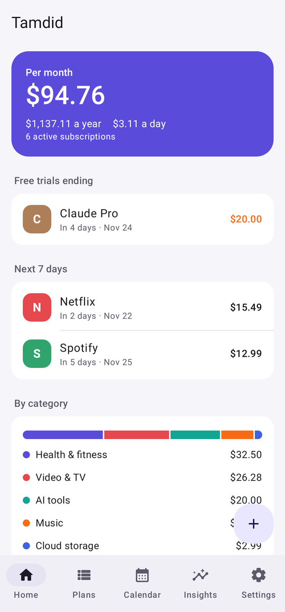
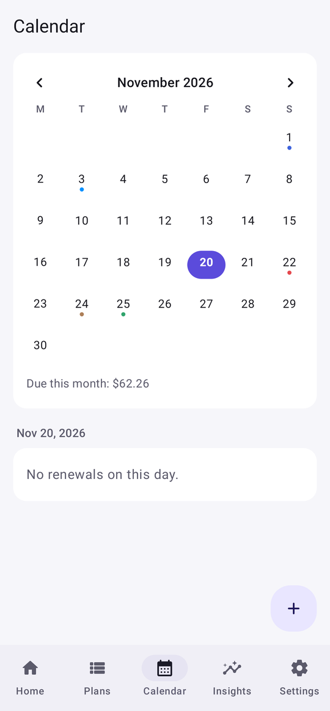
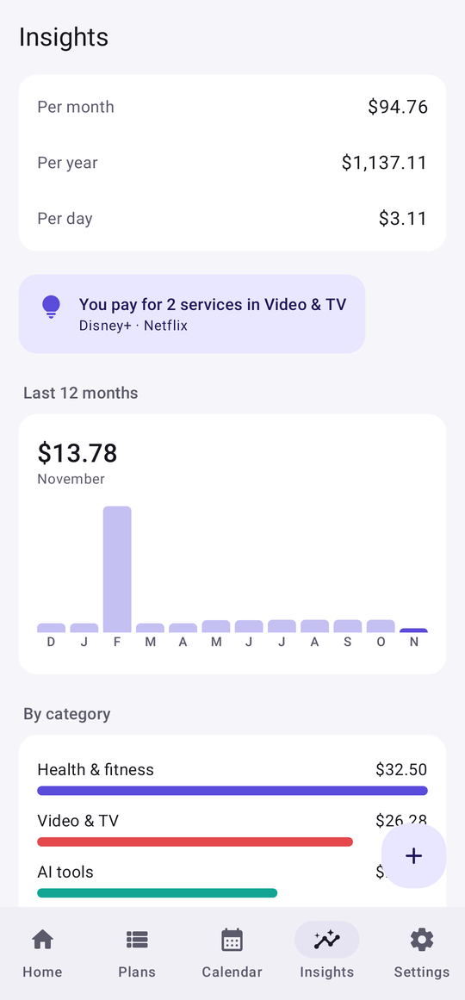
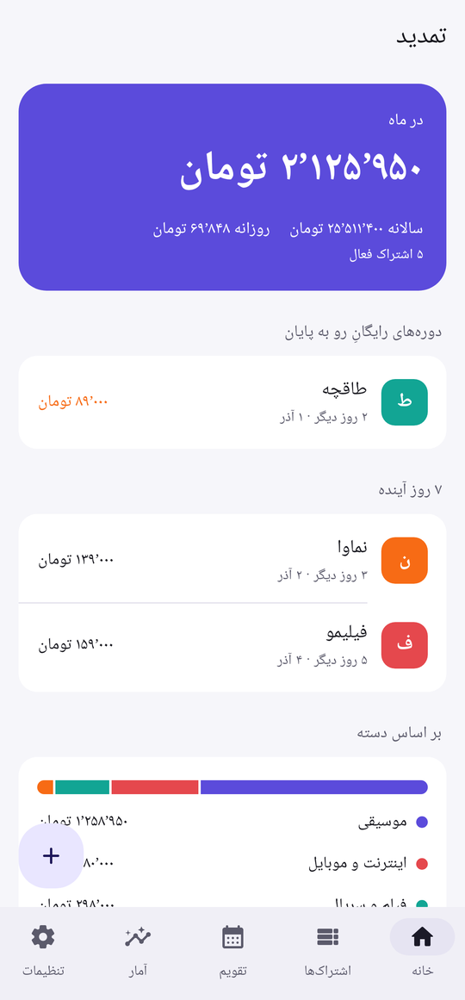

# Tamdid · تمدید

**A free, open-source subscription tracker for iOS and Android.** See what you pay for, what it costs per month, and what renews next, with a reminder before every renewal and every free trial that's about to turn into a payment.

[](https://github.com/Ali-Asadi-Dev/tamdid/actions/workflows/ios.yml)
[](https://github.com/Ali-Asadi-Dev/tamdid/actions/workflows/android.yml)
[](https://github.com/Ali-Asadi-Dev/tamdid/actions/workflows/shared.yml)

No account, no ads, no tracking: data stays on the device. English, Persian, Arabic, Turkish and German, with right-to-left layouts, native digits, the Solar Hijri (Jalali) calendar and the Iranian toman.

<p>
  
  
  
  
</p>

## Features

- **Monthly and yearly totals** across weekly, monthly, yearly or custom cycles, in any of 7 currencies, converted with your own exchange rates (never guessed).
- **Reminders** N days before a renewal, and a separate warning before a free trial ends.
- **Calendar** in Gregorian or Solar Hijri, with every renewal on it.
- **Insights**: the last 12 months of actual payments, spend by category, most expensive plans, and overlapping services ("you pay for 3 video services").
- **Price history**: a price change applies from its date, so "spent so far" stays correct.
- **Pause, resume, cancel** without corrupting the payment history.
- **Backup and restore** as JSON (works across iOS and Android), and export to CSV.

## How it's built

Two native apps that share **rules, not code**:

| | iOS | Android |
|---|---|---|
| UI | SwiftUI, Swift Charts, `@Observable` | Jetpack Compose, Material 3, type-safe Navigation |
| Rules | `TamdidKit` Swift package (builds on Linux) | `:core` Kotlin/JVM module |
| Tests | Swift Testing + XCUITest | JUnit + Robolectric Compose UI tests |

Both implementations run the same **[shared test vectors](shared/test-vectors/business-rules.json)**: renewal dates (including Jan 31 → Feb 28 → Mar 31), Jalali conversions, money formatting in five languages, relative dates. They cannot drift apart without a test failing. That is how a Kotlin bug in Arabic, Turkish and German number separators was caught.

UI text for both apps is generated from one file, [`shared/i18n/translations.json`](shared/i18n/translations.json), by [`tools/i18n.py`](tools/i18n.py).

Read more in [docs/ARCHITECTURE.md](docs/ARCHITECTURE.md), [docs/DESIGN.md](docs/DESIGN.md) and [docs/PRODUCT.md](docs/PRODUCT.md).

## Run it

**iOS** (Xcode 16 or later):

```bash
brew install xcodegen
cd ios && xcodegen generate && open Tamdid.xcodeproj
```

**Android** (Android Studio, JDK 17+):

```bash
cd android && ./gradlew :app:installDebug
```

**Tests**:

```bash
swift test --package-path ios/Packages/TamdidKit
cd android && ./gradlew :core:test :app:testDebugUnitTest :app:lintDebug
python3 tools/i18n.py --check
```

## Project layout

```
ios/
  Packages/TamdidKit/   business rules + storage (Swift package)
  Tamdid/               SwiftUI app
  project.yml           XcodeGen spec (the .xcodeproj is generated)
android/
  core/                 business rules + storage (Kotlin/JVM)
  app/                  Compose app
shared/
  test-vectors/         fixtures both test suites run
  catalog.json          preset services (names only, no logos)
  i18n/                 UI translations for both apps
docs/                   product spec, architecture, design system
```

## License

MIT
